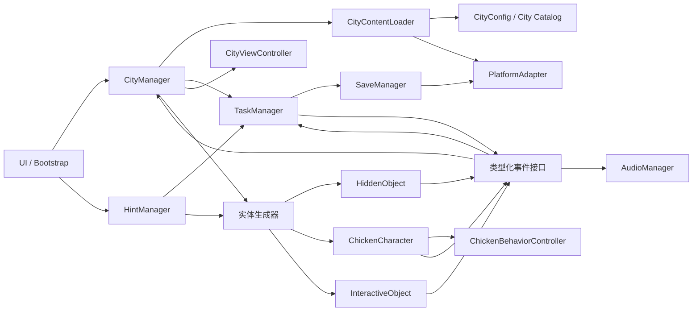

# 架构与目录方案（阶段 0）

## 模块关系



图中的箭头表示调用或事件流，不代表节点间都持有直接引用。当前由场景组合器注入回调，不引入全局巨型管理器。阶段 8 的 `CityManager` 协调城市载入、完成展示、切换和资源释放；`CityContentLoader` 按目录取得 Bundle 与配置并校验。解锁持久化与存档仍由后续阶段实现。

`CityViewController` 只处理触摸/鼠标拖拽、双指/滚轮缩放、边界约束和视口适配。`HiddenObject` 与 `ChickenCharacter` 只报告点击及播放表现，不判断任务。`ChickenBehaviorController` 管理单只鸡的简单行为状态与姿态；初期只支持 idle、walk、peck、sleep。`TaskManager` 唯一负责目标匹配、去重、任务状态及主要目标完成。`HintManager` 从未完成任务选择目标，通过实体注册表查询实时节点位置，尤其是移动鸡。`SaveManager` 管理存档模型和读写时机，通过 `PlatformAdapter` 持久化。`AudioManager` 集中响应事件。`InteractiveObject` 的状态和动作执行在阶段 17 实装。

阶段 5 的 `ChickenBehaviorController` 是独立的轻量状态机，按 `behaviorType` 和对应参数计算位置、朝向及姿态；`ChickenCharacter` 每帧把姿态应用到 `VisualRoot`、`Body`、`Head`、眼睛与 `Zzz` 节点。Walk 只改变角色根节点的地图横坐标，因此点击区域实时随鸡移动。控制器不创建定时器或全局监听，角色停用或销毁后不会继续推进。阶段 6 仍由 `TaskManager` 负责目标判定。

场景级 `TargetInput` 统一分发物品与小鸡点击，先排除拖动和双指手势，再按显示顺序选择命中实体。移动目标必须在按下和抬起时命中同一实体，避免小鸡在长按期间走到手指下方时产生误触。实体分别持有命中区域和点击反馈，返回统一的 `TargetClicked`（类型、ID、标签）。阶段 6 的测试场景仅消费 `TargetInput` 回调这一条通道，把报告交给 `TaskManager`；实体的节点事件不再额外订阅，避免同一次点击被处理两次。

`TaskManager` 不依赖 Cocos 节点。它以 `TaskConfig[]` 初始化，匹配 `hiddenObject`、`chickenId`、`chickenTag`，按任务 ID 幂等完成；同一次点击可以完成多个匹配任务。`getTaskStates()` 提供任务清单，`getProgress()` 分别统计主要和可选目标，并以 `allRequiredComplete` 表示主要探索目标已齐；它不负责切城。任务面板读取这些状态显示勾选，并阻挡下方地图输入。Bootstrap 加载首城后交给 CityManager；每座城市拥有独立 `CityContent` 根节点、地图、输入路由、任务与发现统计。CityManager 从进度回调首次检测主要目标完成，打开 CityCompletionPanel；继续探索保留实例和进度，底部入口可重新打开完成面板。

CityManager 不直接操作微信 API。平台能力仅经 `PlatformAdapter` 接口调用，微信实现与 Web/Editor 回退实现分开；广告接口先保留能力入口。城市完成后仍保持当前场景，玩家可继续探索；只有点击“前往下一座城市”才切换。

`PlatformAdapter` 的首批接口为 `saveLocal`、`loadLocal`、`vibrateShort`、`share`、`showRewardedVideo`、`getSystemInfo`。Web/Editor 对不支持的能力返回明确结果，业务代码不调用 `wx.xxx`。所有监听和订阅由场景组合器管理，并在离城或节点销毁时解绑。

## 建议目录

```text
assets/
  scenes/                  bootstrap.scene, city.scene
  scripts/
    core/                  启动组合、类型化事件
    config/                CityConfig 类型、校验与 CityContentLoader
    city/                  CityManager，城市生命周期与切换
    map/                   CityViewController
    gameplay/              通用发现流程
    character/             ChickenCharacter
    behavior/              ChickenBehaviorController、简单行为
    hidden_object/         HiddenObject
    task/                  TaskManager
    interaction/           InteractiveObject（阶段 17）
    hint/                  HintManager
    save/                  SaveManager
    ui/                    探索界面、完成界面
    audio/                 AudioManager
    platform/              PlatformAdapter、微信与 Web 实现
    utils/                 小型无状态工具
  prefabs/                 characters/, hidden_objects/, ui/, effects/
  bundles/
    common/                通用资源
    city_demo/             首座 Demo 城市的配置与资源
    city_<id>/             后续城市各自的配置与资源
  resources/configs/       city_catalog.json；启动时可直接加载的小型配置
tools/
  art_pipeline/            资源检查与 contact sheet
  city_editor/             后期内部内容编辑器
docs/                      产品、架构、数据格式、美术和构建记录
art/
  reference/               鸡母版与参考
  generated/               生成草稿
  review/                  待审与审核产物
  asset_manifest.json
```

目录是目标布局，不代表阶段 1 要一次建齐。Cocos 的 `.meta`、场景、Bundle 标记和项目设置必须由 Creator 3.8.8 建立或校验。`art/` 保存生产与审核资料；最终被引擎加载的正式资源进入 `assets/`，避免同一资产多处维护。启动目录放在 `resources` 供首次进入游戏时加载；城市配置放各自 Bundle。新增城市只改目录与城市 Bundle。

## 运行数据边界

- 配置：不可变的 CityConfig、City Catalog；由运行时校验器检查。
- 运行态：鸡当前位置、动画状态、互动对象状态、实体可见性；由当前城市场景持有，离城销毁。
- 持久态：当前城市、已解锁/完成城市、每城已完成任务 ID、已发现实体 ID、互动状态、收藏品、纪念品、基础设置；由 SaveManager 以独立存档版本保存。
- 场景切换：先加载和校验新城市，再替换显示内容；失败则保留当前城市并报告错误。释放旧城市资源时确保事件解绑、Tween 停止、节点销毁与引用清理。

## 阶段 8 的切换与资源所有权

CityManager 只在主要目标完成且玩家点击前往按钮时加载 `nextCityId`。新配置通过校验后在未激活的根节点中创建；创建失败会销毁该候选实例并保留旧城市。完成创建后才替换当前实例。请求序号阻止取消或场景退出后的过期结果生效，加载锁阻止连续点击重复请求。加载期间也可选择留在当前城市；迟到的加载结果会归还资源引用。

CityContentLoader 按 Bundle 记录正在加载的 Promise 与使用数，每份 LoadedCity 持有一个 JsonAsset 引用，并提供幂等 `release()`。失败和取消均归还引用；使用数归零才移除由此加载器创建的 Bundle。资源通过 `addRef/decRef` 管理，避免强制释放共享依赖。目前城市实际加载的独立资源只有配置 JSON，后续 SpriteFrame 等资源需纳入同一所有权范围。

离城时先禁用旧根节点、解绑输入并停止 Tween，再调用节点销毁；在 `Director.EVENT_AFTER_DRAW`、Cocos 完成本帧延迟销毁后归还资源。清理可重复调用，也处理场景销毁时子节点已先销毁的情况。任务进度与探索状态仍只在本次运行内存在，持久化留至阶段 10。
